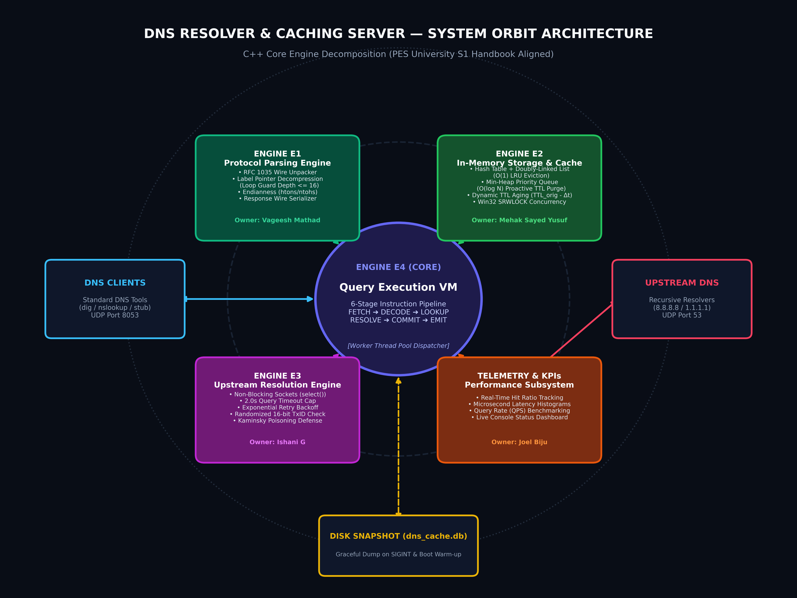
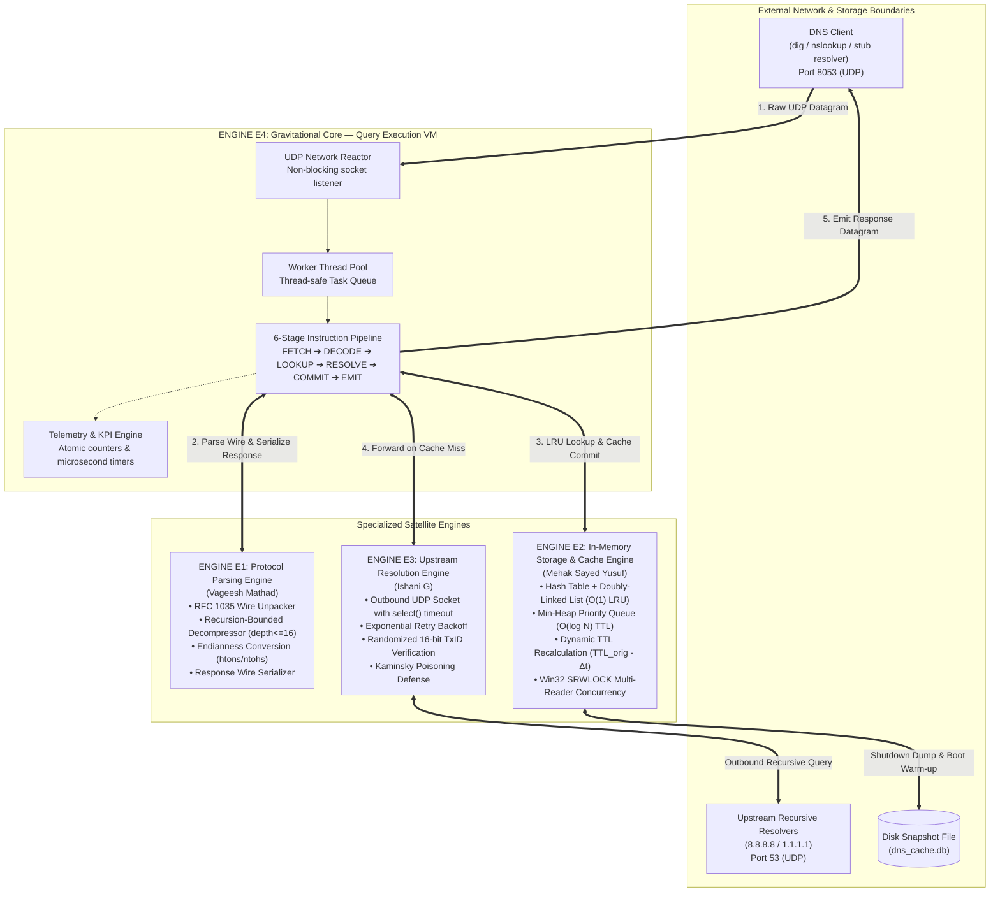
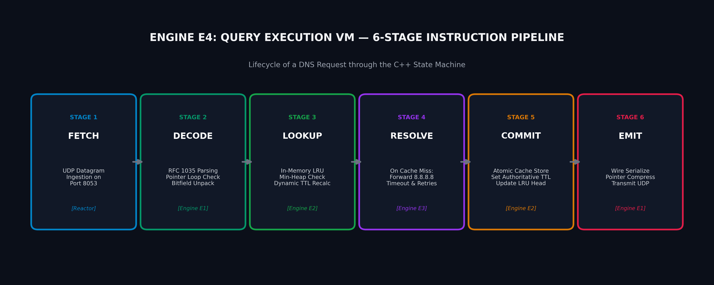
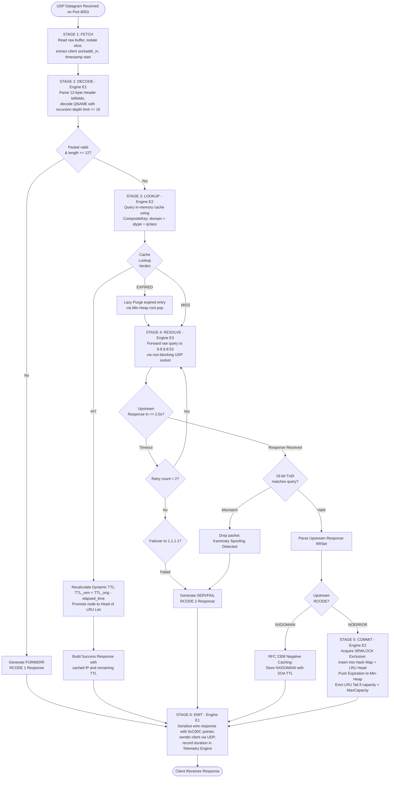
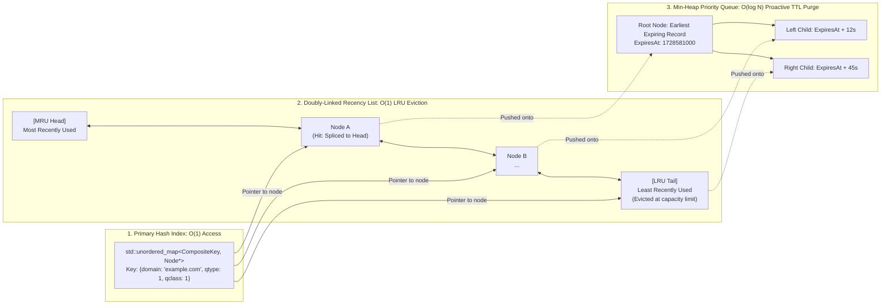
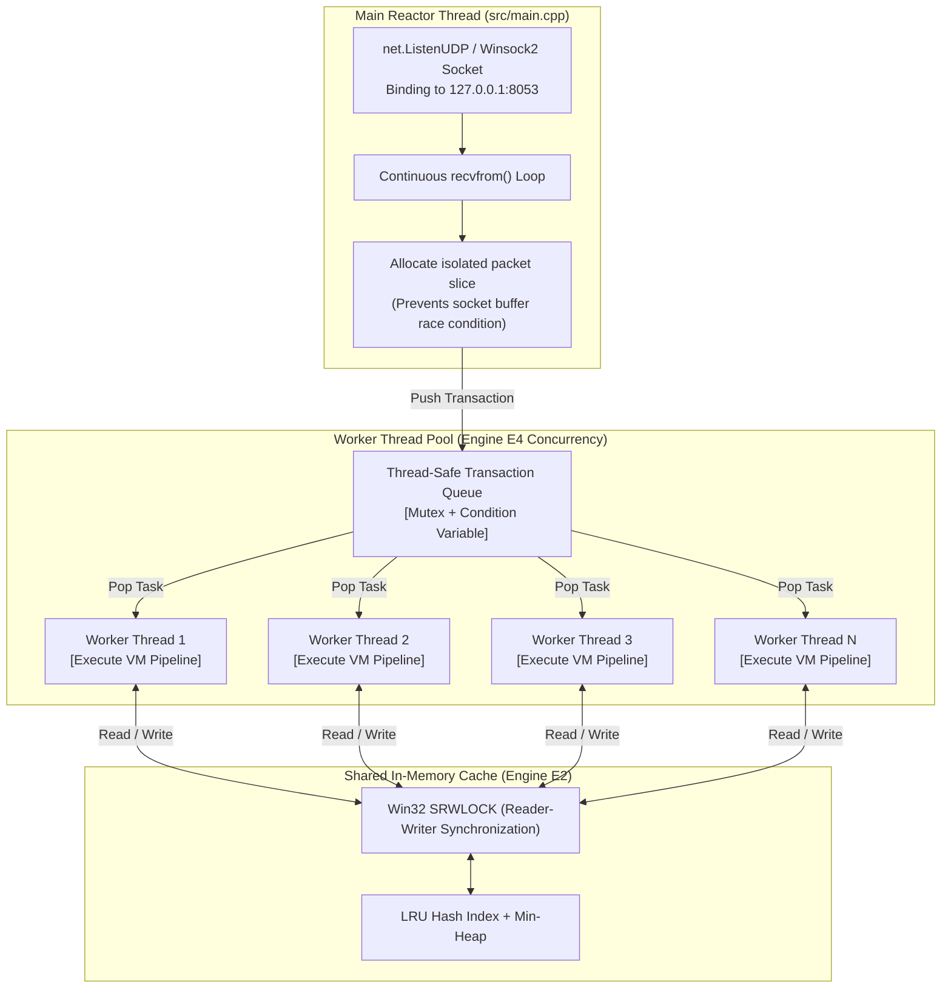

# C++ MASTER PLAN & ARCHITECTURAL SPECIFICATION GUIDE
## DNS Resolver and Caching Server (Academic Theme 4: Network Systems & Tools)

> **CRITICAL LIVING DOCUMENT RULE:**  
> This file is the primary Master Plan Guide for the project.  
> Whenever any design decision, interface, algorithm, engine boundary, or implementation detail is modified or added during development, **this document MUST be updated immediately** so that it remains 100% synchronized with the active C++ codebase.

---

## 1. 30-Second Viva Pitch (Student Voice)

> *"We built an RFC 1035 compliant DNS Resolver and Caching Server from scratch in C++. It listens on UDP port 8053, ingests raw network datagrams, parses DNS wire messages byte-by-byte with zero external libraries, and resolves domain queries concurrently using a worker thread pool. It features a dual-indexed in-memory cache combining an O(1) LRU eviction doubly-linked list with an O(log N) Min-Heap for proactive TTL expiration. When records are not cached, it forwards queries upstream to recursive resolvers like Google's 8.8.8.8, dynamically calculates remaining TTLs on hits, and serializes RFC-compliant response packets using pointer compression. The whole system is governed by a 6-stage Virtual Machine instruction pipeline and tracked with microsecond-precision telemetry."*

---

## 2. Visual System Architecture: The Orbit Model

The system follows an **Orbit Architecture Model** where **Engine E4 (Query Execution VM)** acts as the gravitational center, orchestrating specialized satellite engines and external actors.

### Architectural Diagram


### Architectural Orbit Mermaid Specification


---

## 3. Visual 6-Stage VM Execution Pipeline & Decision Tree

Every incoming DNS request executes through an instruction pipeline modeled as an explicit state machine inside **Engine E4**.

### Pipeline Stages Diagram


### Comprehensive Pipeline Flowchart & Query Condition Matrix


---

## 4. Visual Dual-Index In-Memory Cache Model

Engine E2 provides a high-performance **dual-indexed storage architecture** combining an $O(1)$ LRU eviction list with an $O(\log N)$ proactive Min-Heap priority queue.

### Cache Dual-Index Diagram


### Cache Memory & Data Structure Blueprint


### Key Cache Mechanisms:
1. **$O(1)$ LRU Capacity Eviction:**
   - On cache hit: the accessed node is unlinked and spliced to the head of the doubly-linked list in $O(1)$ time.
   - When cache size reaches `MaxCapacity`: the node at `tail` is severed and deleted from both the list and the hash map in $O(1)$ time.
2. **$O(\log N)$ Proactive TTL Expiration:**
   - Every cached record is inserted into `std::priority_queue` Min-Heap keyed by `ExpiresAt = now + TTL`.
   - The root of the Min-Heap always contains the earliest expiring record across the entire cache.
   - Background sweeps or on-demand checks peek at the root: if `root.ExpiresAt > now`, the entire cache is guaranteed valid without scanning any other entries.
3. **Dynamic TTL Aging:**
   - Remaining TTL is dynamically computed on lookup:
     $$\text{TTL}_{\text{remaining}} = \text{TTL}_{\text{original}} - (t_{\text{current}} - t_{\text{created}})$$
   - Downstream clients receive strictly accurate, decaying TTL countdowns.
4. **Thread Synchronization:**
   - Multi-reader access protected by Windows `SRWLOCK`:
     - Cache queries acquire **Shared Read Lock** (`AcquireSRWLockShared`).
     - Cache insertions/evictions acquire **Exclusive Write Lock** (`AcquireSRWLockExclusive`).

---

## 5. Visual Wire Format & Label Decompression

Engine E1 handles the raw binary serialization and deserialization compliant with **RFC 1035**.

### DNS 12-Byte Header Wire Structure
```
 0                   1                   2                   3
 0 1 2 3 4 5 6 7 8 9 0 1 2 3 4 5 6 7 8 9 0 1 2 3 4 5 6 7 8 9 0 1
+-------------------------------+-------------------------------+
|        Transaction ID         |QR| Opcode |AA|TC|RD|RA| Z  | RCODE|
+-------------------------------+-------------------------------+
|          QDCOUNT (1)          |          ANCOUNT (0/1)        |
+-------------------------------+-------------------------------+
|          NSCOUNT (0)          |          ARCOUNT (0)          |
+-------------------------------+-------------------------------+
```

### Label Decompression & Cycle-Loop Guard
```mermaid
sequenceDiagram
    autonumber
    participant Parser as Engine E1 Parser
    participant Buffer as Datagram Byte Stream (512 bytes)
    participant Depth as Recursion Guard (depth <= 16)

    Parser->>Buffer: Read byte at cursor
    alt Byte < 0xC0 (Normal Label)
        Parser->>Buffer: Read length L; copy L bytes into domain string
        Parser->>Parser: Append '.' and advance cursor by L + 1
    else Byte >= 0xC0 (Compression Pointer)
        Parser->>Depth: Increment depth counter
        alt Depth > 16 (Cyclic Attack Detected)
            Depth-->>Parser: ABORT: Cyclic Pointer Loop Detected!
            Parser->>Parser: Trigger FORMERR (RCODE 1)
        else Depth <= 16 (Valid Pointer)
            Parser->>Buffer: Extract 14-bit pointer offset: (byte[0] & 0x3F) << 8 | byte[1]
            Parser->>Buffer: Jump cursor to offset; continue decoding recursively
        end
    end
```

---

## 6. Visual Concurrency & Thread Pool Architecture

Engine E4 dispatches client requests concurrently using an OS worker thread pool to sustain high query volume without socket drops.



---

## 7. Four Core Engines Decomposition (S1 Aligned)

| Engine | Name & Student Owner | Academic Subject | Core Algorithms & C++ Mechanisms |
| :---: | :--- | :--- | :--- |
| **E1** | **Protocol Parsing & Wire Message Engine**<br>*(Vageesh Mathad)* | **Computer Networks** | • Raw byte-by-byte RFC 1035 wire parser.<br>• Header bitfield manipulation (`QR`, `Opcode`, `AA`, `TC`, `RD`, `RA`, `RCODE`).<br>• Recursion-bounded label pointer decompression (`0xC0`, max depth 16) with cycle-loop detection.<br>• Endianness conversions (`htons`/`ntohs`).<br>• Pointer compression response serializer (`0xC00C`). |
| **E2** | **In-Memory DNS Storage & Cache Engine**<br>*(Mehak Sayed Yusuf)* | **DAA & DBMS** | • **$O(1)$ LRU Eviction**: `std::unordered_map` + Doubly-linked recency list.<br>• **$O(\log N)$ Min-Heap TTL Expiration**: `std::priority_queue` Min-Heap keyed by `ExpiresAt`.<br>• Dynamic TTL recalculation: $TTL_{rem} = TTL_{orig} - \Delta t$.<br>• Native Windows `SRWLOCK` Reader-Writer synchronization.<br>• Durability snapshot dump to `dns_cache.db` on graceful shutdown. |
| **E3** | **Upstream Resolution & Forwarding Engine**<br>*(Ishani G)* | **Computer Networks & OS** | • Outbound UDP client sockets over Winsock2.<br>• Non-blocking `select()` polling with 2.0s timeout.<br>• Exponential retry backoff and failover from `8.8.8.8` to `1.1.1.1`.<br>• Kaminsky poisoning protection: Cryptographic 16-bit TxID validation. |
| **E4** | **Query Execution VM & Telemetry Engine**<br>*(Joel Biju)* | **OSPP** | • 6-Stage VM Instruction Pipeline (`FETCH->DECODE->LOOKUP->RESOLVE->COMMIT->EMIT`).<br>• Condition handling matrix (`HIT`, `MISS`, `EXPIRED`, `NXDOMAIN` RFC 2308, `SERVFAIL`, `FORMERR`).<br>• Multi-threaded worker thread pool with thread-safe queue.<br>• Microsecond latency tracking (`std::chrono::high_resolution_clock`), hit ratio %, and QPS benchmarking. |

---

## 8. Implementation Phases & Milestones

```
PHASE 0: Clean Slate & Build Toolchain       [COMPLETED]
PHASE 1: Architectural & Orbit Diagrams      [COMPLETED]
PHASE 2: Engine E1 (Protocol Parsing)        [CURRENT TARGET]
PHASE 3: Engine E2 (In-Memory Cache & LRU)   [PENDING]
PHASE 4: Engine E3 (Upstream Forwarding)     [PENDING]
PHASE 5: Engine E4 (Virtual Machine Pipeline)[PENDING]
PHASE 6: Telemetry & KPI Benchmarking        [PENDING]
PHASE 7: Main Server Loop & Multi-threading  [PENDING]
PHASE 8: Complete C++ Viva Guide & Docs      [PENDING]
```

### Detailed Phase Breakdown

#### Phase 2 — Engine E1: Protocol Parsing & Wire Message Engine
- **Files:** `include/protocol_engine.hpp`, `src/protocol_engine.cpp`, `tests/test_protocol.cpp`
- **Key Deliverables:**
  - Header bitfield extraction, label pointer decompression with cycle detection (max depth 16), wire serializer.
  - Automated unit tests in `tests/test_protocol.cpp`.
  - Validate with `make test_protocol`, update `CONTEXT.md`, update this Master Plan Guide, and git commit.

#### Phase 3 — Engine E2: In-Memory DNS Storage & Cache Engine
- **Files:** `include/storage_engine.hpp`, `src/storage_engine.cpp`, `tests/test_cache.cpp`
- **Key Deliverables:**
  - Dual-index cache: Hash map + Doubly-linked list for $O(1)$ LRU; Min-Heap for proactive TTL expiration; dynamic TTL recalculation; `SRWLOCK` thread safety; disk snapshot persistence.
  - Automated unit tests in `tests/test_cache.cpp`.
  - Validate with `make test_cache`, update `CONTEXT.md`, update this Master Plan Guide, and git commit.

#### Phase 4 — Engine E3: Upstream Resolution & Network Forwarding Engine
- **Files:** `include/upstream_engine.hpp`, `src/upstream_engine.cpp`, `tests/test_upstream.cpp`
- **Key Deliverables:**
  - Non-blocking UDP socket forwarder to 8.8.8.8, 2.0s timeout, exponential retries, randomized TxID matching.
  - Automated unit tests in `tests/test_upstream.cpp`.
  - Validate with `make test_upstream`, update `CONTEXT.md`, update this Master Plan Guide, and git commit.

#### Phase 5 — Engine E4: Query Execution Virtual Machine
- **Files:** `include/vm_engine.hpp`, `src/vm_engine.cpp`, `tests/test_vm_integration.cpp`
- **Key Deliverables:**
  - 6-stage instruction pipeline (`FETCH->DECODE->LOOKUP->RESOLVE->COMMIT->EMIT`).
  - Condition handling matrix (`HIT`, `MISS`, `EXPIRED`, `NXDOMAIN` negative cache, `SERVFAIL`, `FORMERR`).
  - End-to-end integration tests simulating complete client transactions.
  - Validate with `make test_vm`, update `CONTEXT.md`, update this Master Plan Guide, and git commit.

#### Phase 6 — Telemetry & KPI Benchmarking Subsystem
- **Files:** `include/telemetry_engine.hpp`, `src/telemetry_engine.cpp`
- **Key Deliverables:**
  - Real-time hit ratio tracking, microsecond latency histograms, console dashboard.
  - Update `CONTEXT.md`, update this Master Plan Guide, and git commit.

#### Phase 7 — Server Main Entry Loop, Concurrency & Live Testing
- **Files:** `src/main.cpp`
- **Key Deliverables:**
  - UDP socket listener on port 8053 with worker thread pool.
  - Live validation with `dig @127.0.0.1 -p 8053 example.com` and `nslookup`.
  - Update `CONTEXT.md`, update this Master Plan Guide, and git commit.

#### Phase 8 — Comprehensive C++ Project Master Guide & Viva Prep
- **Files:** `docs/CPP_MASTER_GUIDE.md`
- **Key Deliverables:**
  - Complete viva defense guide with 30 in-depth professor questions & answers.
  - Finalize all benchmarks, test outputs, and `CONTEXT.md`.

---

## 9. Course Mapping Matrix for Faculty Viva

| Subject | Where it appears in our C++ Code | Code Proof & Mechanism |
| :--- | :--- | :--- |
| **Computer Networks** | Wire format parsing, UDP sockets, upstream resolution, RFC 1035 compliance | `protocol_engine.cpp`, `upstream_engine.cpp`, big-endian bitfields, pointer compression (`0xC00C`). |
| **OSPP** | Thread pool concurrency, non-blocking socket I/O, Win32 `SRWLOCK` & `CRITICAL_SECTION`, signal handling | `main.cpp`, `vm_engine.cpp`, worker thread queues, RAII lock guards, non-blocking `select()`. |
| **DAA** | Dual-index cache algorithms: $O(1)$ LRU doubly-linked list & $O(\log N)$ Min-Heap priority queue | `storage_engine.cpp`, `std::unordered_map` hash indexing, node splicing, min-heap priority queue. |
| **DBMS** | In-memory key-value store, composite primary key, dynamic TTL expiry, ACID write locking, snapshot durability | `storage_engine.cpp`, `dns_cache.db` file serialization, multi-reader single-writer synchronization. |

---

## 10. Living Synchronization Protocol

1. **Continuous Updates:** Whenever code modifications, algorithm adjustments, or interface additions occur during implementation, they **MUST be synchronized back into this file**.
2. **State Preservation:** Every phase completion is logged in [CONTEXT.md](file:///a:/dns-resolver-caching-server/CONTEXT.md).
3. **Git Commits:** Every milestone is committed with a descriptive git commit.
4. **Official Deliverables:** All submitted Gate 0/Gate 1 PPTs and Handbook in `DOCUMENTATION/` remain preserved.
