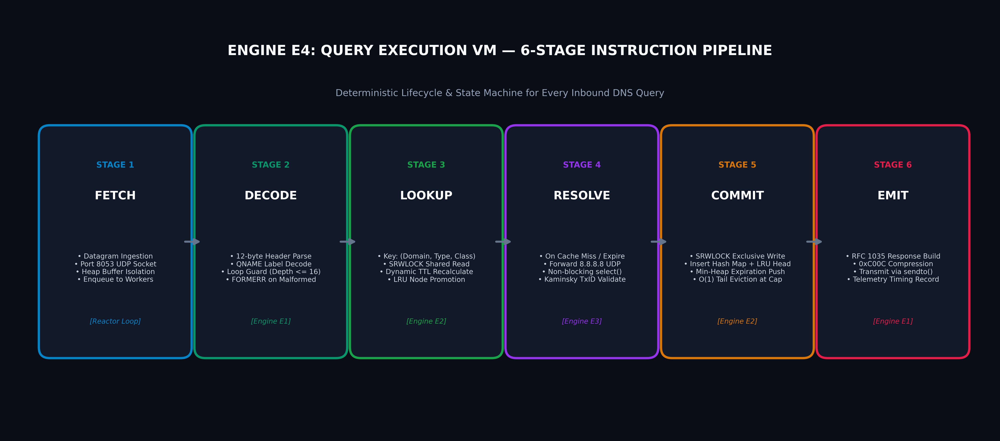
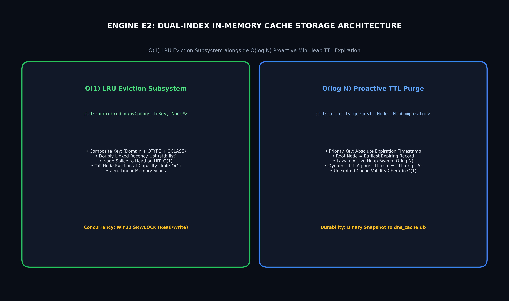

# DNS Resolver & Caching Server (C++)

[](https://isocpp.org/)
[](https://www.ietf.org/rfc/rfc1035.txt)
[-orange.svg)](https://learn.microsoft.com/en-us/windows/win32/winsock/windows-sockets-start-page-2)
[]()
[-purple.svg)]()

An RFC 1035 compliant **DNS Resolver and In-Memory Caching Server** built from scratch in **C++** using **Windows Sockets 2 (`ws2_32`)** and native Windows synchronization primitives (`SRWLOCK`).

The system ingests raw UDP datagrams on port `8053`, unpacks DNS wire bitfields without external libraries, resolves domain queries concurrently using a worker thread pool, and accelerates lookups using a dual-indexed cache combining **$O(1)$ LRU capacity eviction** with an **$O(\log N)$ Min-Heap for proactive TTL expiration**.

---

## 🏛️ System Orbit Architecture


The project decomposes into an **Orbit Model** where **Engine E4 (Query Execution VM)** acts as the central state machine dispatching to three specialized satellite engines:

| Engine | Engine Name | Student Owner | Course Alignment | Core Responsibilities |
| :---: | :--- | :--- | :--- | :--- |
| **E1** | **Protocol Parsing & Wire Message Engine** | Vageesh Mathad | **Computer Networks** | RFC 1035 wire datagram unpacking, bitfield extraction, recursion-bounded pointer decompression (depth $\le$ 16), wire serialization (`0xC00C`). |
| **E2** | **In-Memory Storage & Cache Engine** | Mehak Sayed Yusuf | **DAA & DBMS** | Hash table + Doubly-linked list for $O(1)$ LRU eviction; Min-Heap priority queue for $O(\log N)$ proactive TTL purge; dynamic remaining TTL aging; `SRWLOCK` thread safety; disk snapshot (`dns_cache.db`). |
| **E3** | **Upstream Resolution & Network Forwarding Engine** | Ishani G | **Computer Networks & OS** | Recursive query forwarder to `8.8.8.8` / `1.1.1.1` over non-blocking UDP sockets (`select()`), exponential retry backoff, Kaminsky 16-bit TxID defense. |
| **E4** | **Query Execution VM & Telemetry Engine** | Joel Biju | **OSPP** | 6-Stage VM instruction pipeline (`FETCH` ➔ `DECODE` ➔ `LOOKUP` ➔ `RESOLVE` ➔ `COMMIT` ➔ `EMIT`), error condition routing (`HIT`, `MISS`, `EXPIRED`, `NXDOMAIN`, `SERVFAIL`, `FORMERR`), thread pool, real-time microsecond telemetry. |

---

## ⚙️ 6-Stage VM Execution Pipeline



Every inbound client request executes deterministically through an explicit 6-stage instruction pipeline:
1. **FETCH:** Network reactor ingests raw 512-byte datagram on port 8053, creates an isolated buffer copy, and pushes the transaction into the worker queue.
2. **DECODE (Engine E1):** Unpacks the 12-byte header, decodes domain labels, and verifies pointer dereference depth ($\le 16$) to eliminate cyclic freeze exploits.
3. **LOOKUP (Engine E2):** Queries cache via composite key `(domain, qtype, qclass)`. On a **HIT**, dynamically recalculates decaying remaining TTL ($TTL_{rem} = TTL_{orig} - \Delta t$) and splices node to MRU head.
4. **RESOLVE (Engine E3):** On a **MISS / EXPIRED**, dispatches raw query to upstream `8.8.8.8:53` with non-blocking socket timeout (2.0s) and validates the 16-bit TxID against Kaminsky spoofing.
5. **COMMIT (Engine E2):** Commits upstream answer into in-memory hash index and Min-Heap. If memory limit is reached, evicts tail node in $O(1)$ time.
6. **EMIT (Engine E1):** Serializes compliant RFC 1035 response packet with `0xC00C` pointer compression and transmits datagram back to the client via `sendto()`.

---

## 🧠 Dual-Index In-Memory Cache Model



- **$O(1)$ LRU Capacity Eviction:** `std::unordered_map` provides instantaneous key lookups while an intrusive doubly-linked list (`std::list`) tracks recency. Access promotes to head; overflow drops tail.
- **$O(\log N)$ Proactive TTL Expiration:** `std::priority_queue` Min-Heap keyed by absolute expiration timestamp (`ExpiresAt = now + TTL`). Root node always holds the earliest expiring entry, enabling immediate purging without full-table scans.
- **Dynamic TTL Aging:** Downstream clients receive strictly non-stale countdowns calculated at query time.
- **Thread Synchronization:** Multi-reader single-writer locking via Windows `SRWLOCK` (`AcquireSRWLockShared` for lookups, `AcquireSRWLockExclusive` for insertions/evictions).
- **Snapshot Persistence:** Serializes active valid cache entries to `dns_cache.db` on graceful `SIGINT` (Ctrl+C) shutdown, and performs cache warm-up on boot.

---

## 🛠️ Build and Run Instructions

### Prerequisites
- **OS:** Windows 10 / 11
- **Compiler:** MinGW GCC (`g++` supporting C++14 or higher)
- **Make:** `mingw32-make`
- **Libraries:** Windows Sockets (`-lws2_32`)

### 1. Clone the Repository
```bash
git clone https://github.com/mehaksayedyusuf/dns-resolver-caching-server.git
cd dns-resolver-caching-server
```

### 2. Build the Server
```bash
mingw32-make all
```
The compiled binary is written to `bin/dns_server.exe`.

### 3. Run the Server
```bash
./bin/dns_server.exe
```
*The server will bind to UDP `127.0.0.1:8053` and output live resolution telemetry.*

### 4. Run Modular Engine Tests
```bash
mingw32-make test_protocol   # Run Engine E1 test suite
mingw32-make test_cache      # Run Engine E2 test suite
mingw32-make test_upstream   # Run Engine E3 test suite
mingw32-make test_vm         # Run Engine E4 integration test suite
```

---

## 🧪 Testing with Standard DNS Tools

In a separate terminal, test resolution against the server using standard DNS client utilities:

### Using `dig`
```bash
dig @127.0.0.1 -p 8053 example.com A
```

### Using `nslookup`
```bash
nslookup -port=8053 example.com 127.0.0.1
```

---

## 📂 Project Directory Structure

```
dns-resolver-caching-server/
├── Makefile                                   # MinGW C++ build system (all, test, clean)
├── README.md                                  # This documentation landing page
├── CONTEXT.md                                 # Session state continuity tracker
├── DOCUMENTATION/                             # Official deliverables & living guides
│   ├── CPP_MASTER_PLAN_GUIDE.md               # Master architectural blueprint & viva guide
│   ├── Gate_0_team11_document.docx            # Submitted Gate 0 Document
│   ├── Gate_0_team11_ppt.pptx                 # Submitted Gate 0 Presentation
│   ├── Team11_Gate1.pptx                      # Submitted Gate 1 Presentation
│   └── Team11_S1_Student_Handbook.docx        # Submitted S1 Requirements Handbook
├── diagrams/                                  # 300-DPI ultra-high-resolution architectural graphics
│   ├── system_orbit_diagram.png               # System Orbit Architecture diagram
│   ├── engine_pipeline_diagram.png            # 6-Stage VM Instruction Pipeline diagram
│   ├── cache_lru_minheap_diagram.png          # Dual-Index Cache Architecture diagram
│   ├── wire_protocol_format_diagram.png       # RFC 1035 Header & Decompression diagram
│   └── concurrency_threadpool_diagram.png     # Reactor & Worker Thread Pool diagram
├── include/                                   # C++ header files (.hpp)
│   ├── common.hpp                             # RFC 1035 constants, big-endian helpers, RAII locks
│   ├── protocol_engine.hpp                    # Engine E1 header
│   ├── storage_engine.hpp                     # Engine E2 header
│   ├── upstream_engine.hpp                    # Engine E3 header
│   ├── vm_engine.hpp                          # Engine E4 header
│   └── telemetry_engine.hpp                   # Telemetry & KPI header
├── src/                                       # C++ engine implementations (.cpp)
└── tests/                                     # Modular test suites (.cpp)
```

---

## 👥 Team 11 

- **Mehak Sayed Yusuf** (`01fe24bci012`) — *Engine E2: In-Memory Storage & Cache Engine*
- **Vageesh Mathad** (`01fe24bci008`) — *Engine E1: Protocol Parsing & Wire Message Engine*
- **Ishani G** (`01fe22bci009`) — *Engine E3: Upstream Resolution & Network Forwarding Engine*
- **Joel Biju** (`01fe24bci021`) — *Engine E4: Query Execution VM & Telemetry Engine*

**Faculty Guide:** Mr. Pavankumar S  
**Theme:** Theme 4: Network Systems and Tools (Academic 3-Credit Mini Project)
