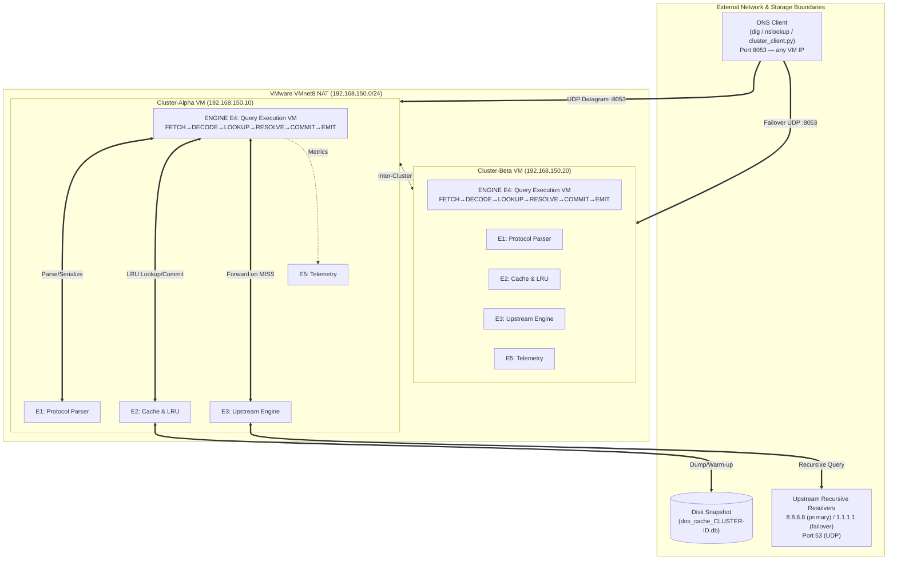
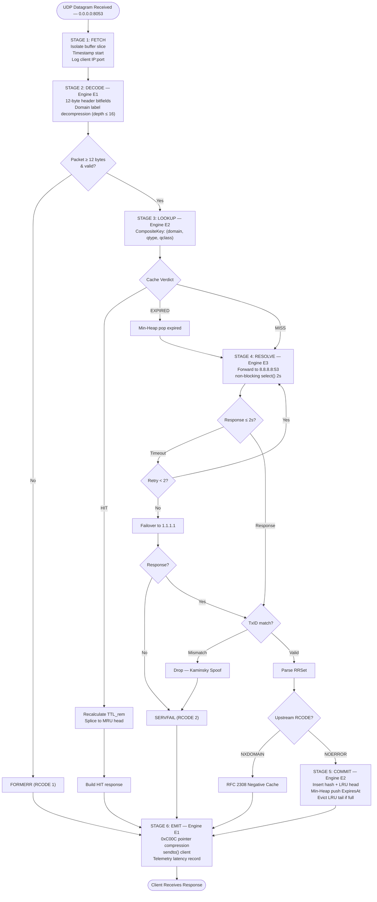
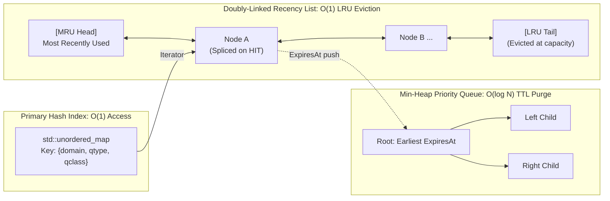
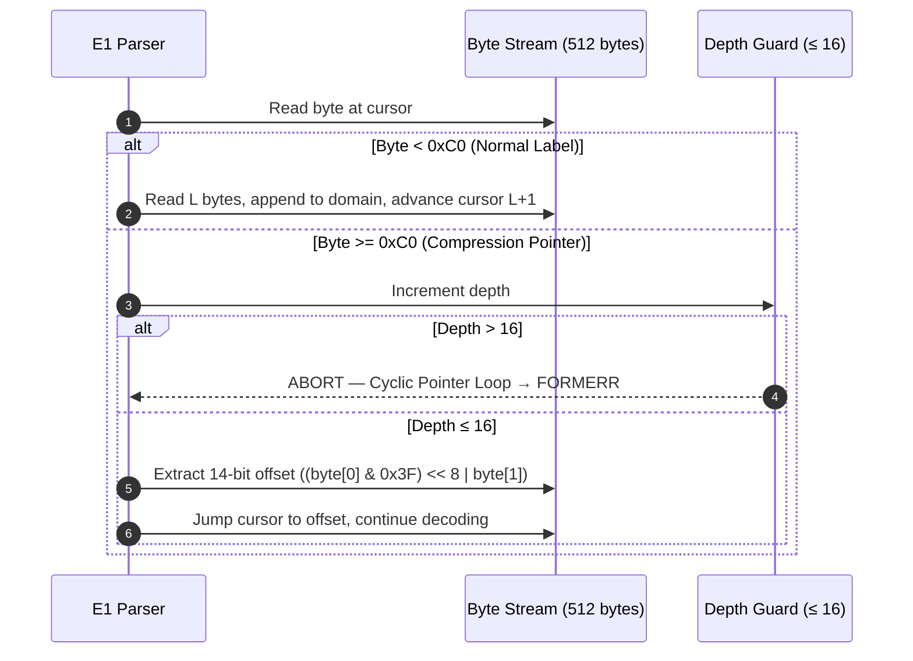
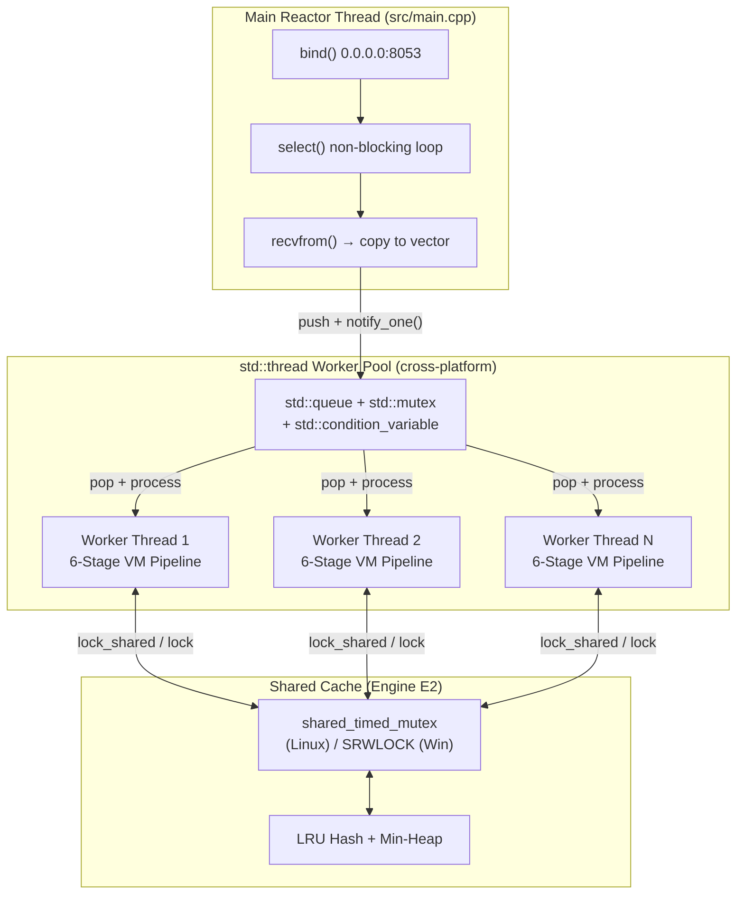

# C++ MASTER PLAN & ARCHITECTURAL SPECIFICATION GUIDE
## DNS Resolver & Caching Server — Distributed VM Multi-Cluster
### Academic Theme 4: Network Systems & Tools (Team 11)

> **LIVING DOCUMENT:** Whenever code is modified, this file must be updated immediately to remain synchronized with the codebase.

---

## 1. 30-Second Viva Pitch

> *"We built an RFC 1035 compliant DNS Resolver and Caching Server from scratch in C++ (C++14), deployed as a distributed multi-cluster system on VMware Workstation Pro. It listens on UDP `0.0.0.0:8053` — reachable from any client on the VMnet8 subnet. It parses DNS wire messages byte-by-byte, resolves queries via a cross-platform worker thread pool, and accelerates lookups using a dual-indexed cache: O(1) LRU (hash + doubly-linked list) and O(log N) Min-Heap proactive TTL expiration. Cache misses forward to `8.8.8.8`/`1.1.1.1` over non-blocking UDP with randomized TxID defense. In benchmark runs, cache hits resolved in ~0.414 ms median vs ~154 ms upstream. The system runs on two Ubuntu Server VMs (Cluster-Alpha and Cluster-Beta) with identity-tagged telemetry and automatic client failover."*

---

## 2. Visual System Architecture: VM Multi-Cluster Orbit Model

The system follows an **Orbit Architecture** where **Engine E4 (Query Execution VM)** is the gravitational center, coordinating satellite engines, deployed across multiple VMs behind VMnet8.



---

## 3. Visual 6-Stage VM Execution Pipeline



---

## 4. Dual-Index In-Memory Cache (Engine E2)



**Key Cache Mechanisms:**
1. **O(1) LRU Promotion:** `std::list::splice(begin(), list_, it)` — O(1) pointer swaps, no allocation.
2. **O(1) LRU Eviction:** `pop_back()` + hash erase at capacity.
3. **O(log N) Min-Heap Sweep:** Root always = earliest expiring. Proactive purge without full scan.
4. **Dynamic TTL:** `TTL_rem = ExpiresAt − now`. Downstream gets accurate countdown.
5. **Thread Safety:** `std::shared_timed_mutex` (Linux) or `SRWLOCK` (Windows). Shared for reads, exclusive for writes.

---

## 5. Wire Format & Label Decompression (Engine E1)

```
DNS 12-Byte Header:
 0                   1                   2                   3
 0 1 2 3 4 5 6 7 8 9 0 1 2 3 4 5 6 7 8 9 0 1 2 3 4 5 6 7 8 9 0 1
+-------------------------------+-------------------------------+
|        Transaction ID         |QR| Opcode |AA|TC|RD|RA| Z | RCODE|
+-------------------------------+-------------------------------+
|          QDCOUNT (1)          |          ANCOUNT (0/1)        |
+-------------------------------+-------------------------------+
|          NSCOUNT (0)          |          ARCOUNT (0)          |
+-------------------------------+-------------------------------+
```



---

## 6. Concurrency & Thread Pool (Engine E4)



---

## 7. Five-Engine Decomposition

| Engine | Name & Owner | Subject | Core Algorithms & C++ |
|:---:|:---|:---|:---|
| **E1** | Protocol Parsing & Wire Message Engine *(Vageesh Mathad)* | Computer Networks | RFC 1035 wire parser, 14-bit pointer decompression (depth ≤ 16), `0xC00C` serializer, big-endian `htons`/`ntohs` |
| **E2** | In-Memory DNS Storage & Cache Engine *(Mehak Sayed Yusuf)* | DAA & DBMS | O(1) LRU (`unordered_map` + `list::splice`), O(log N) Min-Heap (`priority_queue`), dynamic TTL, `shared_timed_mutex`/`SRWLOCK`, `dns_cache_<id>.db` |
| **E3** | Upstream Resolution & Forwarding Engine *(Ishani G)* | CN & OS | Non-blocking `fcntl`/`ioctlsocket`, `select(sock+1,...)`, exponential backoff, randomized TxID (`std::mt19937`), `8.8.8.8`→`1.1.1.1` failover |
| **E4** | Query Execution VM Engine *(Joel Biju)* | OSPP | 6-stage pipeline, `std::thread` pool, `std::mutex`+`condition_variable`, `--cluster-id` tagging, `signal`/`SetConsoleCtrlHandler` |
| **E5** | Telemetry Subsystem *(Joel Biju)* | OSPP | `std::atomic<uint64_t>` counters, CAS min/max latency, hit ratio %, QPS, live dashboard |

---

## 8. Implementation Phases

```
PHASE 0: Clean Slate & Build Toolchain              [COMPLETED]
PHASE 1: Architectural & Orbit Diagrams             [COMPLETED]
PHASE 2: Engine E1 — Protocol Parsing              [COMPLETED]
PHASE 3: Engine E2 — In-Memory Cache & LRU         [COMPLETED]
PHASE 4: Engine E3 — Upstream Forwarding           [COMPLETED]
PHASE 5: Engine E4 — Virtual Machine Pipeline      [COMPLETED]
PHASE 6: Telemetry & KPI Benchmarking              [COMPLETED]
PHASE 7: Main Server Loop & Multi-threading        [COMPLETED]
PHASE 8: Viva Guide & Docs                         [COMPLETED]
PHASE 9: VM Multi-Cluster Architecture             [COMPLETED]
  ├─ Cross-platform POSIX/Win32 abstraction (common.hpp)
  ├─ --bind, --cluster-id, --peer CLI args (main.cpp)
  ├─ fcntl/ioctlsocket portable upstream (upstream_engine.cpp)
  ├─ Auto-detecting cross-platform Makefile
  ├─ VMware Workstation Pro deployment guide
  ├─ deploy_vm_cluster.sh — one-click VM deployer
  ├─ cluster_client.py — multi-cluster test client
  ├─ verify_implementation.py — 72-check verification suite
  └─ 72/72 checks passed (VERIFICATION_REPORT.txt)
```

---

## 9. Course Mapping Matrix for Faculty Viva

| Subject | Where It Appears | Code Proof |
|:---|:---|:---|
| **Computer Networks** | Wire format, UDP sockets, upstream resolution, RFC 1035 | `protocol_engine.cpp`, `upstream_engine.cpp`, `0xC00C` compression |
| **OSPP** | Thread pool, Reactor, cross-platform mutex, non-blocking I/O, VM cluster deploy | `main.cpp`, `vm_engine.cpp`, `std::thread`, VMware VMs |
| **DAA** | Dual-index cache: O(1) LRU + O(log N) Min-Heap | `storage_engine.cpp`, `list::splice`, `priority_queue` |
| **DBMS** | In-memory key-value store, composite key, write locking, snapshot durability | `storage_engine.cpp`, `dns_cache_<id>.db` |

---

## 10. Living Synchronization Protocol

1. **Continuous Updates:** Any code change → update this file immediately.
2. **State Preservation:** Every phase logged in `CONTEXT.md`.
3. **Git Commits:** Every milestone committed with descriptive message.
4. **Official Deliverables:** `DOCUMENTATION/` files remain preserved and never deleted.
5. **VM Deployment:** See `VM_CLUSTER_IMPLEMENTATION.md` for resumption checkpoints.
